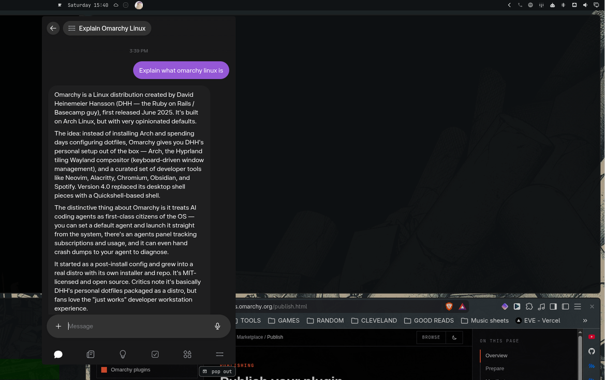
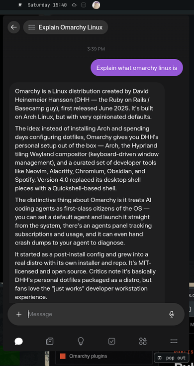

# Omusey

**[Muse](https://muse.ai/) in the [Omarchy](https://omarchy.org) bar.** Click the avatar and your Muse chat drops down from the top of the screen. Click again and it tucks away, still loaded, right where you left it.



No new window to manage, no tab to find. When you do want a full window, the `pop out` tab under the dropdown's corner turns it into one.

## Install

```sh
omarchy plugin add https://github.com/telep-io/omusey.git --enable
omarchy restart shell
```

That's it. The widget lands in the center of the bar; move it with `omarchy bar move telep.muse --section right` (or `left`).

The first click opens muse.ai as an Omarchy web app, so you sign in once, in your own browser, like on any other site. After that the chat is one click away.

### Requirements

Everything below ships with Omarchy; there is nothing extra to install.

- Omarchy Quattro (the Quickshell-based shell, Hyprland with Lua config)
- A Chromium-based default browser (Chromium, Brave, Chrome...) for the web app window
- `jq`

### Remove

```sh
omarchy plugin remove telep.muse
```

It leaves nothing behind: no config edits, no state files, no services.

## Use


| Action | Result |
|---|---|
| Click the avatar | Drop the chat down, or tuck it away |
| Click `pop out` (just below the dropdown's bottom-right corner) | Turn the dropdown into a normal tiled window on the current workspace |
| Click the avatar while popped out | Focus that window |
| Close the popped-out window, then click the avatar | A fresh dropdown |

The dropdown opens on whichever monitor you clicked, centered under the avatar. Tucked away, Muse keeps running, so a reply that was streaming is finished when you come back.



## Settings

Set from the bar's widget settings, or from a terminal:

```sh
omarchy bar set telep.muse width 560             # dropdown width in px, 360-1200 (default 480)
omarchy bar set telep.muse heightPercent 70      # dropdown height, % of the screen, 30-90 (default 60)
omarchy bar set telep.muse avatar ~/Pictures/my-muse.png
omarchy bar set telep.muse iconColor theme       # mark color: brand blue #0079f3 by default
```

Size changes apply the next time the dropdown opens.

### The mark's color

`iconColor` decides how the default Muse mark is painted: `theme` follows the bar's foreground (the same off-white/accent tones every other icon takes from the active theme), `accent`/`urgent` follow those theme roles, and any hex or CSS color (the default `#0079f3` brand blue) pins it regardless of theme. It is applied as a flat color over the mark's shape; a custom `avatar` image always keeps its own pixels.

### Your own avatar

Out of the box the bar shows the Muse mark. The screenshots above show it with a personal Muse character instead, which is one setting:

1. Save a picture of your Muse as a square PNG (transparent corners if you want it round).
2. `omarchy bar set telep.muse avatar /path/to/it.png`

The plugin cannot see your Muse account, so it does not pick your avatar up by itself or follow changes to it. If you change your character, save the image again.

## How it works

Muse has no public API and the Omarchy shell cannot host a web view, so the dropdown *is* the real muse.ai web app: a borderless floating browser window parked in a Hyprland special workspace named `muse`. Toggling a special workspace slides it in from the top, which is the whole animation.

| File | Job |
|---|---|
| `BarWidget.qml` | Draws the avatar, works out where the dropdown goes, listens for Hyprland's `activespecial` event, and shows the `pop out` tab while the dropdown is down |
| `bin/muse-toggle` | Registers a named runtime window rule with `hyprctl eval`, launches the web app with `omarchy-launch-webapp`, toggles the workspace, and handles pop-out |
| `muse.png` | The default bar icon, painted flat via the `iconColor` setting (brand blue `#0079f3` default, or `theme` to follow the bar foreground) |

The window rule is registered at runtime, every launch, so the plugin never edits your Hyprland config and a config reload cannot break it.

## Privacy

The plugin makes no network requests and reads no browser data. Everything you type goes to muse.ai through your own browser, exactly as if you had opened the site yourself. Like every Omarchy plugin it runs unsandboxed with your user permissions; it is about 150 lines, so have a read.

## Troubleshooting

- **Click focuses a normal window instead of dropping down.** A Muse window is already open somewhere (popped out, or opened by hand). Close it and click the avatar again.
- **Nothing happens on click.** Run `~/.config/omarchy/plugins/telep.muse/bin/muse-toggle` in a terminal and read the error; the usual cause is no Chromium-based default browser.
- **The widget is missing after install.** `omarchy-shell shell rescanPlugins`, then `omarchy plugin enable telep.muse`.

## Not affiliated

Muse is a Meta product. This is an unofficial launcher for its public web app, not affiliated with or endorsed by Meta.

## License

[MIT](LICENSE)
